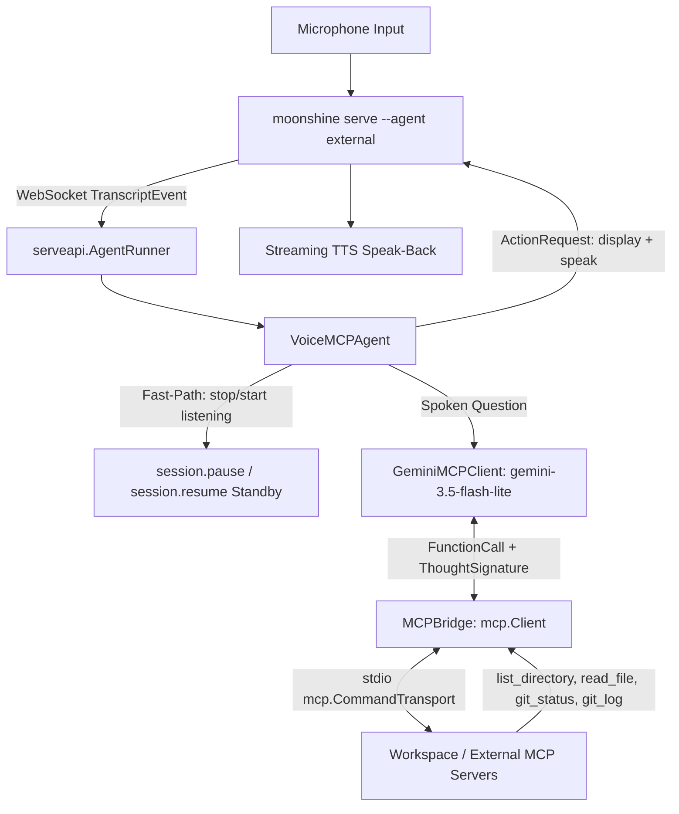

# samples/voice-mcp-assistant — Tier 2 Gemini + MCP Voice Assistant

A Tier 2 external Go voice agent for `moonshine serve` that connects live speech-to-text transcripts to **Google Gemini** (`gemini-3.5-flash-lite` default, `gemini-3.8-flash`, or `gemini-4-argon`) and dispatches function calls to external **Model Context Protocol (MCP)** tool servers over stdio (`mcp.CommandTransport`).

Whereas [`samples/mcp-transcribe`](../mcp-transcribe/) exposes Moonshine as an MCP tool server for desktop LLM hosts, **`voice-mcp-assistant` is the inverse**: Moonshine is the live voice front-end, and the Go agent acts as an MCP client inspecting your workspace files, directories, and git state hands-free.

## Sample Rating

| Axis | Rating / Details |
|---|---|
| **Tier** | Tier 2 (Go extension via `pkg/serveapi` + MCP Client SDK) |
| **Complexity** | 3/5 |
| **Setup Cost** | Medium (local `moonshine serve` + `GEMINI_API_KEY`) |
| **Pillars** | Composability, Control, Observability, Privacy |
| **Industry / Use Case** | Voice Coding Assistant, Hands-Free DevOps & Repo Inspection |
| **Appeal** | 5/5 |

---

## Architecture



---

## Safety Controls

1. **Read-Only by Default:** Mutating MCP tools (`write_*`, `delete_*`, `create_*`, `git_commit`, `run_*`, `exec_*`) are filtered out during MCP tool discovery and rejected at call time unless you explicitly pass `-allow-write`.
2. **Single-Directory Workspace Sandbox:** The built-in stdio MCP server resolves all paths relative to `-root` and rejects `..` traversal or absolute paths outside the sandbox.
3. **Bounded Tool-Calling Rounds:** Capped at `-max-rounds 4` per spoken utterance to prevent runaway tool loops.
4. **Thought Signature Preservation:** Preserves Gemini 3.5+ and Gemini 4 `ThoughtSignature` payloads across multi-round function calls (`cand.Content` replay) so multi-step tool chains execute without HTTP 400 signature errors.
5. **Native Server Standby (`v0.11.0+`):** Saying *"stop listening"* dispatches `session.pause` with `PauseArgs{Passthrough: ["start listening", "resume listening"]}`, suppressing ambient speech on the server while keeping the microphone active for voice unpause (or press `Enter` in the terminal to resume).

---

## Quickstart

### 1. Start `moonshine serve`

In Terminal 1 (from the repository root):

```sh
export MOONSHINE_LIB_DIR="$(pwd)/.moonshine/lib"
./bin/moonshine serve --transport ws --allow-actions --agent external
```

### 2. Run `voice-mcp-assistant`

In Terminal 2:

```sh
cd samples/voice-mcp-assistant
export GEMINI_API_KEY="your-api-key"

# Connects to moonshine serve and spawns the built-in sandboxed stdio MCP server
go run . -addr ws://localhost:8765/ws -root ../..
```

### 3. Connect External Third-Party MCP Servers (`-mcp-cmd`)

Pass `-mcp-cmd` (repeatable) to launch any external stdio MCP server subprocess:

```sh
go run . -addr ws://localhost:8765/ws \
  -mcp-cmd "npx -y @modelcontextprotocol/server-filesystem ../.." \
  -mcp-cmd "uvx mcp-server-git --repository ../.."
```

---

## Empirical Model Comparison (`moonshine-go-ybvs`)

Measured using `go run . -benchmark -root ../..` across 6 workspace & git queries (including a 2-round autonomous `read_file` chain on `AGENTS.md`) against the live stdio MCP server subprocess:

| Model | Tool Accuracy | First-Call LLM p50 (mean) | Total LLM p50 (mean) | MCP Tool Mean | End-to-End Turn p50 (mean) | Avg Spoken Words |
|---|---|---|---|---|---|---|
| **`gemini-3.5-flash-lite`** *(default)* | **6/6 (100%)** | **556ms (598ms)** | **1,120ms (1,264ms)** | 10.0ms | **1,122ms (1,274ms)** | **17.7 words** |
| `gemini-3.8-flash` | 6/6 (100%) | 2,196ms (2,142ms) | 4,311ms (5,684ms) | 9.6ms | 4,341ms (5,693ms) | 27.5 words |
| `gemini-4-argon` | 6/6 (100%) | 2,943ms (5,489ms) | 7,785ms (12,341ms) | 13.1ms | 7,786ms (12,355ms) | 30.7 words |

**Takeaway:** `gemini-3.5-flash-lite` achieves 100% tool selection accuracy (matching `gemini-3.8-flash` and `gemini-4-argon`, including autonomous multi-round tool retries) while delivering **3.9x lower end-to-end turn latency than `gemini-3.8-flash`** and **6.9x lower latency than `gemini-4-argon`**, making it the ideal default for interactive voice cascades.
